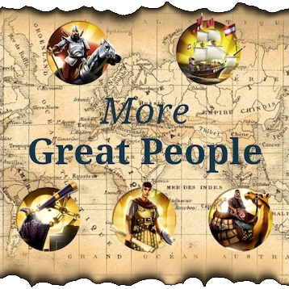

# More Great People for Unciv

[Unciv](https://github.com/yairm210/Unciv) mod to add more contextual Great People names.



## Requirements

- An Unciv version that includes [yairm210/Unciv#14197](https://github.com/yairm210/Unciv/pull/14197)
- The *Civ V - Gods & Kings* ruleset

## Installation

1. In Unciv, open *Mods* from the main menu
2. Search for *More Great People*, or download this repository with *Download from URL*
3. Enable the mod when starting a new game

## How it works

Names live in [`jsons/UnitNameGroups.json`](jsons/UnitNameGroups.json). Each group is named `[Type] - [Era]` and is tagged with its Great Person type, so names are only given out during the matching era:

```json
{
	"name": "[Engineer] - [Atomic era]",
	"unitNames": ["Norman Foster", "Konrad Zuse", "Soichiro Honda"],
	"uniques": [
		"Only available <during the [Atomic era]>",
		"Engineer"
	]
}
```

Types: General, Khan, Admiral, Scientist, Engineer, Merchant, Artist, Writer, Musician and Prophet. Writer and Musician groups are only used by rulesets that have those Great People.

## Contributing names

- Real, historical people only
- Place them in the era they were most active, and under the type they are best known for:

  | Era | Years |
  |---|---|
  | Ancient | ~4000 BC – 500 BC |
  | Classical | 499 BC – 799 AD |
  | Medieval | 800 – 1399 |
  | Renaissance | 1400 – 1799 |
  | Industrial | 1800 – 1899 |
  | Modern | 1900 – 1949 |
  | Atomic | 1950 – 1990 |
  | Information | 1991 – present |
  | Future | Influential people alive today |

- Use one spelling, and don't add someone already listed under the same type
- Keep the file valid JSON, with tabs for indentation

## Sources

- [More Great People](https://steamcommunity.com/sharedfiles/filedetails/?id=3425494532) by Gaia
- Artwork by Manitorio
- [Great Prophet list](https://forums.civfanatics.com/threads/1-vt-add-unique-names-for-great-prophets.679785/) by Tomatekh
